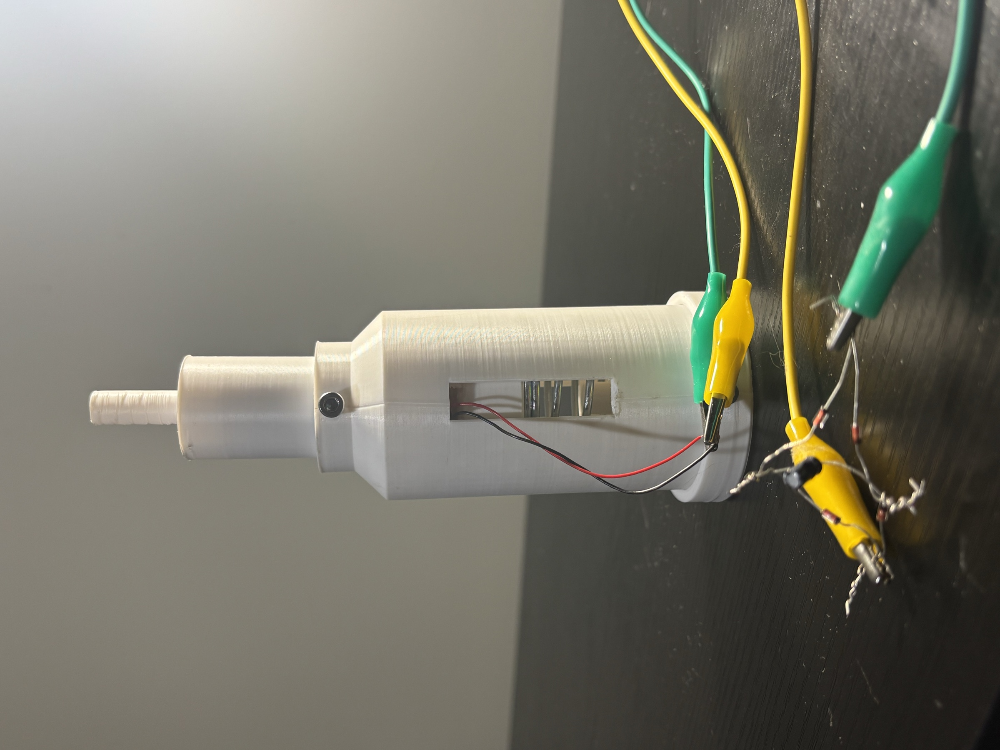
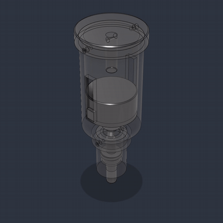
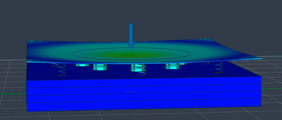
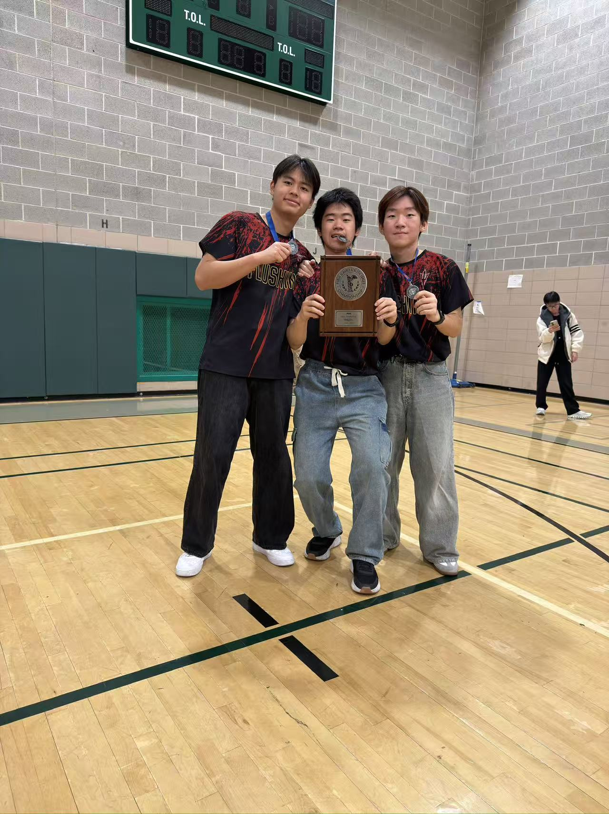

# Wenhao Jia

**High school senior · Chemical Engineering & Bioengineering**

I’m learning embedded systems and sensors to control experimental variables and collect more reliable measurements.

[Featured work](#featured-work) · [Badminton](#varsity-badminton) · [More projects](#more-projects)

## Featured work

<table>
  <tr>
    <td width="50%" valign="top">
      

      <h3>Piezoelectric Floor Tile</h3>
      
<strong>Can a footstep charge a capacitor?</strong> Our team tested three mechanical designs. In the single-disc comparison, V3 stored <strong>72.48 µJ per step</strong> on average versus <strong>11.63 µJ</strong> for the baseline, with 100 steps per design.

      
I modeled the V2 assembly in CAD, helped design and animate V3, collected test data, and wrote the first manuscript draft.

      
<a href="https://github.com/jw3422951-ops/piezoelectric-floor-tile"><strong>See the prototype and test data →</strong></a>

    </td>
    <td width="50%" valign="top">
      

      <h3>Cat Food Storage and Automatic Feeder</h3>
      
<strong>What happens to dry food while it waits in a feeder?</strong> In my 24-container study, foil with 4 g of silica gel averaged <strong>4.50% loss on drying</strong> on Day 21 versus <strong>7.60%</strong> for the foil control.

      
I ran the experiment, measured loss on drying, pH, and iodine spot intensity, and wrote the report. I also modeled and animated the team feeder’s motor and gears.

      
<a href="https://github.com/jw3422951-ops/cat-food-storage-study"><strong>See the study and feeder →</strong></a> · <a href="https://github.com/jw3422951-ops/cat-food-storage-study/blob/main/reports/cat-food-storage-experiment.pdf">Lab report</a>

    </td>
  </tr>
</table>

Floor tile design, test setup, and CAD animations

Across **100 single steps per design**, V3 stored **72.48 µJ per step** on average, about **6.23 times** the baseline's **11.63 µJ**. The spread relative to the mean (sample standard deviation divided by the mean) was **17.7%** for V3 and **54.6%** for the baseline. In separate 20-step charging runs, V3 stored an average of **1,484.62 µJ in total**, compared with **348.65 µJ** for the baseline.

<table>
  <tr>
    <td valign="top">
      
With Shaoxuan Xiong and Shuoqi Yang, I explored how a floor tile could transfer the motion of a footstep to a piezoelectric disc and store the resulting electrical energy in a capacitor. We started by replicating a published design. In our build, the glue-stick contacts deformed and damaged the discs, which raised a more specific question. <strong>How could we protect the disc and make the contact more consistent from one step to the next?</strong>

      
<strong>How the design evolved</strong>

      <ul>
        <li><strong>V1 · Sponge pads.</strong> We replaced the glue-stick contacts with sponge pads in a tile with eight discs wired in parallel. The pads provided a softer contact, but the output still depended on where we stepped.</li>
        <li><strong>V2 · Spring and impactor.</strong> We added moving impactors and return springs to explore whether the impactor could separate and make contact again as the upper plate rose. The voltage varied across steps and often dropped quickly after the first compression. Through the acrylic plate, we could see the relative motion between the plate and the impactors.</li>
        <li><strong>V3 · Triggered release.</strong> We developed a center-punch mechanism in which a step compresses a spring until a mechanical trigger releases the moving part. That release delivers a short impact to the disc. We 3D-printed and assembled the mechanism, then verified that it could trigger.</li>
      </ul>
      
<strong>My contribution</strong>

      <ul>
        <li><strong>V2 assembly and motion.</strong> I brought the component models together into the V2 CAD assembly and made animations to illustrate how the parts moved under load. I recorded and transcribed the upper plate's displacement under footsteps to provide motion data for the team's simulation.</li>
        <li><strong>V3 mechanism and testing.</strong> I helped design and model the trigger mechanism and animated its release sequence. I also helped measure, record, and transcribe data from both V2 and V3 tests.</li>
        <li><strong>Manuscript.</strong> I wrote the first draft, organizing the design changes, experimental methods, and results for the team to review and revise.</li>
      </ul>
      
<a href="https://github.com/jw3422951-ops/piezoelectric-floor-tile#design-evolution">Design evolution</a> · <a href="https://github.com/jw3422951-ops/piezoelectric-floor-tile#ab-experiments">Experiments and data</a> · <a href="https://github.com/jw3422951-ops/piezoelectric-floor-tile/blob/main/CREDITS.md">Team contributions</a>

      

        
        
         V3 assembled prototype and mechanism components
      

    </td>
    <td align="center" valign="top" width="250">
      
 V3 center-punch animation

      
 V2 displacement simulation

      
 V1-derived baseline and V3 storage results

    </td>
  </tr>
</table>

### How we tested the two designs

We compared V3 against a single-disc version of the V1 sponge design, using the same disc model and rectifier for both. One person alternated between the two designs, wearing the same shoes and stepping in the same location. Before each single-step trial, we discharged the **4.7 µF capacitor**, then used its voltage change to calculate how much energy was stored.

The chart shows individual single-step measurements and cumulative storage after 5, 10, and 20 steps. Error bars in the charging runs show sample standard deviation across five runs per condition.

## Varsity badminton

<table>
  <tr>
    <td width="155" align="center"></td>
    <td valign="middle">
      <h3>PSAL City Championship Runner-Up</h3>
      
Flushing Campus Boys Varsity Badminton finished second in New York City in 2026. I was co-captain, played No. 1 singles, and coached teammates in singles and doubles.

      
<a href="activities/badminton.md"><strong>See the photos and my role →</strong></a>

    </td>
  </tr>
</table>

## More projects

<table>
  <tr>
    <td width="50%" valign="top">
      
      <h3>Independent Chemistry</h3>
      
I planned and carried out my own experiments, including a 28-day copper sulfate crystal growth study. The collection has <strong>49 entries and 10 written reports</strong>.

      
<a href="https://github.com/jw3422951-ops/chemistry-portfolio"><strong>Browse experiments →</strong></a>

    </td>
    <td width="50%" valign="top">
      
      <h3>CCNY DNA Detectives</h3>
      
I counted visible tumors in fruit fly larvae with my team, prepared Figure 1, and helped write the paper. The comparison between Domeless and White RNAi was inconclusive.

      
<a href="https://github.com/jw3422951-ops/ccny-dna-detectives"><strong>Read the team study →</strong></a>

    </td>
  </tr>
  <tr>
    <td valign="top">
      
      <h3>Fermentation Monitoring</h3>
      
I proposed tracking batch yeast fermentation with low-cost sensors and using Monod kinetics to explain growth. The presentation earned <strong>Third Prize</strong> at the 2026 Youth AI Leadership Speech Challenge.

      
<a href="https://github.com/jw3422951-ops/fermentation-monitoring-proposal"><strong>Explore the proposal →</strong></a>

    </td>
    <td valign="top">
      
      <h3>CreditCAN at Cooper Union</h3>
      
I modeled the team recycling concept in Onshape, then built an Arduino Mega 2560 sorter with a rotating chute. The team concept earned an <strong>Honor Award</strong>.

      
<a href="https://github.com/jw3422951-ops/cooper-union-projects#creditcan"><strong>See how the sorter works →</strong></a>

    </td>
  </tr>
</table>

## What I’m working toward

For my next yeast fermentation study, I want to see whether different conditions produce distinct patterns in the sensor readings over time. [Planned fermentation research](https://github.com/jw3422951-ops/fermentation-monitoring-proposal#future-research)
