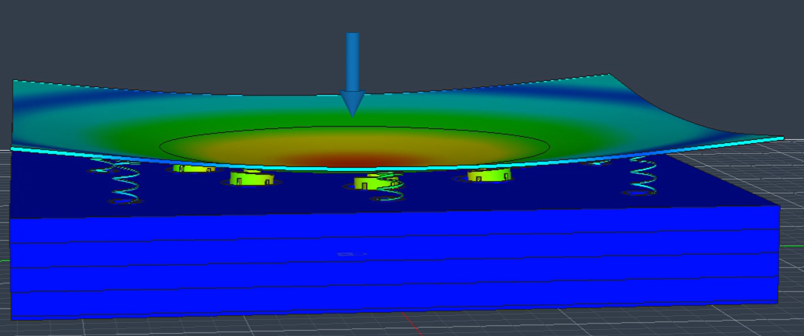
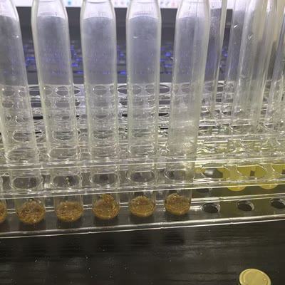
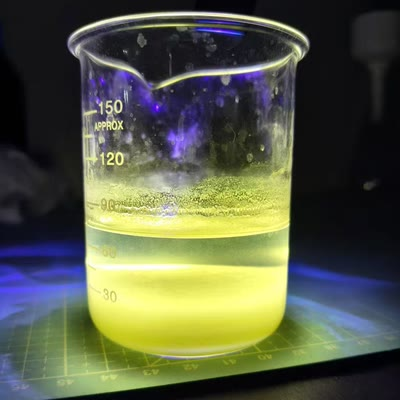
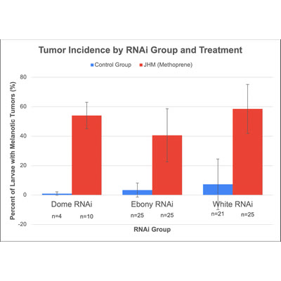
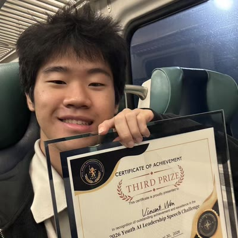
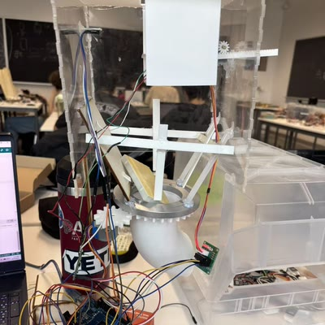

# Wenhao Jia

**Bioengineering · Chemical Engineering**

## [Piezoelectric Floor Tile — Footstep Energy Harvesting](https://github.com/jw3422951-ops/piezoelectric-floor-tile)

<table>
  <tr>
    <td valign="top">
      
With Shaoxuan Xiong and Shuoqi Yang, I explored how a floor tile could transfer the motion of a footstep to a piezoelectric disc and store the resulting electrical energy in a capacitor. We started by replicating a published design. In our build, the glue-stick contacts deformed and damaged the discs, which raised a more specific question. <strong>How could we protect the disc and make the contact more consistent from one step to the next?</strong>

      
<strong>How the design evolved</strong>

      <ul>
        <li><strong>V1 · Sponge pads.</strong> We replaced the glue-stick contacts with sponge pads in a tile with eight discs wired in parallel. The pads provided a softer contact, but the output still depended on where we stepped.</li>
        <li><strong>V2 · Spring and impactor.</strong> We added moving impactors and return springs to explore whether the impactor could separate and make contact again as the upper plate rose. The voltage varied across steps and often dropped quickly after the first compression. Through the acrylic plate, we could see the relative motion between the plate and the impactors.</li>
        <li><strong>V3 · Triggered release.</strong> We developed a center-punch mechanism in which a step compresses a spring until a mechanical trigger releases the moving part. That release delivers a short impact to the disc. We 3D-printed and assembled the mechanism, then verified that it could trigger.</li>
      </ul>
      
<strong>My contribution</strong>

      <ul>
        <li><strong>V2 assembly and motion.</strong> I brought the component models together into the V2 CAD assembly and made animations to illustrate how the parts moved under load. I recorded and transcribed the upper plate's displacement under footsteps to provide motion data for the team's simulation.</li>
        <li><strong>V3 mechanism and testing.</strong> I helped design and model the trigger mechanism and animated its release sequence. I also helped measure, record, and transcribe data from both V2 and V3 tests.</li>
        <li><strong>Manuscript.</strong> I wrote the first draft, organizing the design changes, experimental methods, and results for the team to review and revise.</li>
      </ul>
      
<a href="https://github.com/jw3422951-ops/piezoelectric-floor-tile#design-evolution">Design evolution</a> · <a href="https://github.com/jw3422951-ops/piezoelectric-floor-tile#ab-experiments">Experiments and data</a> · <a href="https://github.com/jw3422951-ops/piezoelectric-floor-tile/blob/main/CREDITS.md">Team contributions</a>

    </td>
    <td align="center" valign="top" width="250">
      
 V3 assembled prototype

      
 V3 mechanism components

      
 V2 center-load simulation

    </td>
  </tr>
</table>

### How we tested the two designs

We compared V3 against a single-disc version of the V1 sponge design, using the same disc model and rectifier for both. One person alternated between the two designs, wearing the same shoes and stepping in the same location. Before each single-step trial, we discharged the **4.7 µF capacitor**, then used its voltage change to calculate how much energy was stored.

Across **100 single steps per design**, V3 stored **72.48 µJ per step** on average, about **6.23 times** the baseline's **11.63 µJ**. The spread relative to the mean (sample standard deviation divided by the mean) was **17.7%** for V3 and **54.6%** for the baseline. In separate 20-step charging runs, V3 stored an average of **1,484.62 µJ in total**, compared with **348.65 µJ** for the baseline.

*Single-step measurements are on the left. On the right, error bars show sample standard deviation across five charging runs per condition.*

## Cat Food Storage Study

While building an automatic cat feeder, I wondered what happened to the food while it sat in the container. I designed a storage experiment to compare plastic and foil containers at four silica gel amounts, then wrote up the methods and results. [Read my cat food storage report (PDF)](https://github.com/jw3422951-ops/cat-food-storage-study/blob/main/reports/cat-food-storage-experiment.pdf)

## Project gallery

<table>
  <tr>
    <td align="center" valign="top" width="190">
      <a href="https://github.com/jw3422951-ops/piezoelectric-floor-tile"> <strong>Piezoelectric Floor Tile</strong></a>
       Footstep energy harvesting · Team project
    </td>
    <td align="center" valign="top">
      <a href="https://github.com/jw3422951-ops/cat-food-storage-study"> <strong>Cat Food Storage</strong></a>
       24-container study and report
    </td>
    <td align="center" valign="top">
      <a href="https://github.com/jw3422951-ops/chemistry-portfolio/blob/main/README.md"> <strong>Chemistry Portfolio</strong></a>
       49 entries · 10 reports
    </td>
  </tr>
  <tr>
    <td align="center" valign="top">
      <a href="https://github.com/jw3422951-ops/ccny-dna-detectives"> <strong>CCNY DNA Detectives</strong></a>
       Spring course team study
    </td>
    <td align="center" valign="top">
      <a href="https://github.com/jw3422951-ops/fermentation-monitoring-proposal"> <strong>Fermentation Monitoring</strong></a>
       Sensor proposal · Third Prize
    </td>
    <td align="center" valign="top">
      <a href="https://github.com/jw3422951-ops/cooper-union-projects"> <strong>Cooper Union</strong></a>
       CreditCAN and class projects
    </td>
  </tr>
</table>

## Selected projects

| Project | My contribution | Explore |
| --- | --- | --- |
| **Piezoelectric Floor Tile** | I modeled the V2 assembly in CAD, helped design and animate the V3 mechanism, collected test data, and wrote the first manuscript draft. | [Prototype and results](https://github.com/jw3422951-ops/piezoelectric-floor-tile) · [Team credits](https://github.com/jw3422951-ops/piezoelectric-floor-tile/blob/main/CREDITS.md) |
| **Cat Food Storage and Automatic Feeder** | I ran the 24-container storage study, built the feeder prototype, and simulated its motor and gear motion in CAD. | [Study results and prototype](https://github.com/jw3422951-ops/cat-food-storage-study) |
| **Chemistry Portfolio** | I plan and carry out my own chemistry experiments and document what I observe in reports, photos, and videos. | [Chemistry overview](https://github.com/jw3422951-ops/chemistry-portfolio/blob/main/README.md) |
| **CCNY DNA Detectives** | I prepared Figure 1 and contributed to the paper and presentation on Domeless RNA interference in fruit flies. | [Final team paper and slides](https://github.com/jw3422951-ops/ccny-dna-detectives) |
| **Fermentation Monitoring** | I developed a proposal for school labs to use low-cost sensors and Monod kinetics to study batch yeast fermentation. | [Proposal and Third Prize](https://github.com/jw3422951-ops/fermentation-monitoring-proposal) |
| **Cooper Union Summer Projects** | I modeled the CreditCAN team concept in Onshape, then independently built an Arduino Mega 2560 sorter based on it. The team concept earned an Honor Award. | [Two years of design and fabrication](https://github.com/jw3422951-ops/cooper-union-projects) |

## What I’m working toward

I’m learning embedded systems and sensors to control experimental variables and collect more reliable measurements. For my next yeast fermentation study, I want to see whether different conditions produce distinct patterns in the sensor readings over time. [Planned fermentation research](https://github.com/jw3422951-ops/fermentation-monitoring-proposal#future-research)
