# Wenhao Jia

I’m a high school senior in New York City interested in **chemical engineering and bioengineering**. I like using chemistry to investigate problems I notice in everyday life. When food went moldy in our basement workshop, I wondered how we could store kibble in the automatic feeder we were building at Alba Studio.

I designed a **24-container study** to compare storage conditions. On Day 21, kibble stored in foil with 4 g of silica gel averaged **4.50% loss on drying**, compared with **7.60%** in foil alone. I’m learning to use embedded systems and sensors to control experimental conditions and take more reliable measurements.

| What I do | Tools and methods |
| --- | --- |
| **Program & control** | C/C++ for Arduino, sensor integration, and stepper motor control |
| **Model & build** | Onshape CAD, motion simulation, 3D printing, and laser cutting |
| **Experiment & analyze** | Experimental design, measurement, and ImageJ analysis |

[Badminton](#varsity-badminton) · [Featured work](#featured-work) · [More projects](#more-projects) · [Cat food results and chart](https://github.com/jw3422951-ops/cat-food-storage-study#results)

## Varsity badminton

<table>
  <tr>
    <td width="210" align="center"><a href="activities/badminton.md">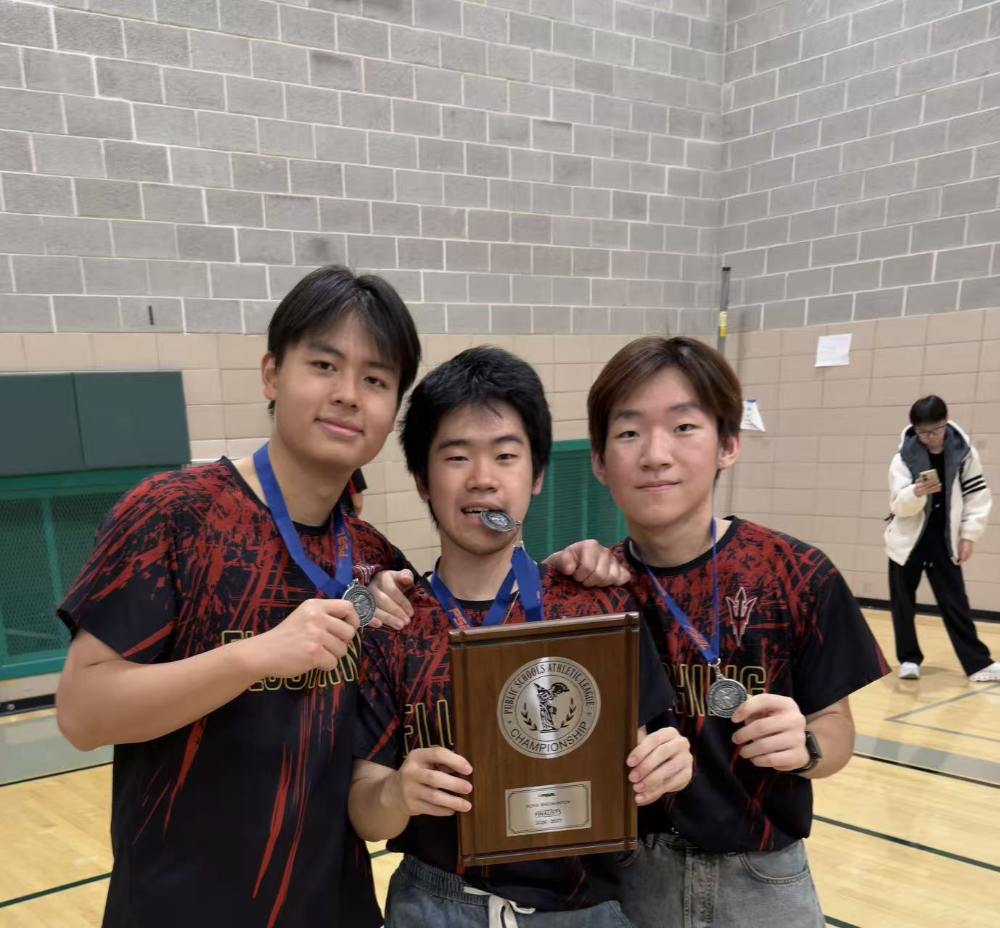</a></td>
    <td valign="middle">
      <h3>New York City PSAL Championship Runner-Up</h3>
      
Flushing Campus Boys Varsity Badminton finished second in New York City in 2026, the <strong>first city runner-up finish in program history</strong>. I was <strong>co-captain and No. 1 singles player</strong>, and I coached teammates in singles and doubles during practice.

      
<a href="activities/badminton.md"><strong>See the city final and team photos →</strong></a>

    </td>
  </tr>
</table>

## Featured work

<table>
  <tr>
    <td width="50%" valign="top">
      
<a href="https://github.com/jw3422951-ops/piezoelectric-floor-tile">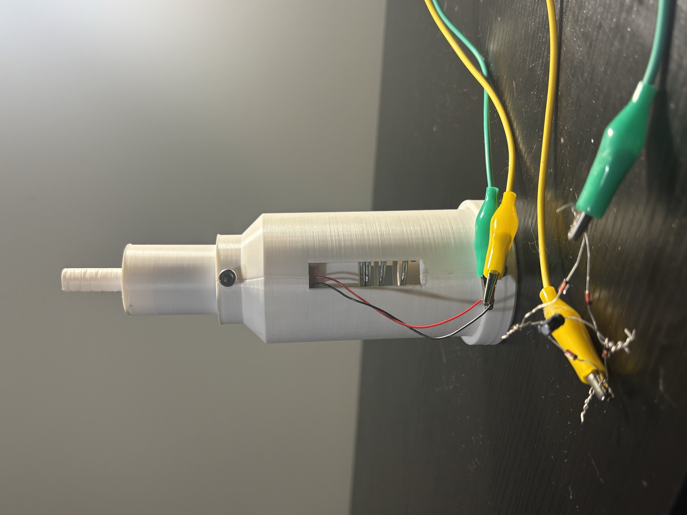</a>

      <h3>Piezoelectric Floor Tile</h3>
      
<strong>How can a slow footstep deliver a sharp strike to a piezoelectric disc?</strong> The contacts in our first prototype damaged the discs. After testing sponge pads and a spring impactor, our team built a center-punch mechanism that compresses a spring underfoot and releases it at a trigger point. In single-disc tests, V3 stored an average of <strong>72.48 µJ per step</strong> in a capacitor, compared with <strong>11.63 µJ</strong> for the sponge baseline (100 steps per design).

      
<strong>My contribution.</strong> I independently built the <strong>V3 CAD model</strong> and created both animations below, showing the V2 top plate deflecting under load and the V3 trigger releasing. I recorded how far the V2 plate moved under footsteps and helped design the V3 trigger with the team. I wrote the <strong>full first draft</strong>, from the abstract through future directions, and revised it based on Shaoxuan Xiong’s feedback.

      
<a href="https://github.com/jw3422951-ops/piezoelectric-floor-tile"><strong>See the prototype and test data →</strong></a>

    </td>
    <td width="50%" valign="top">
      <table align="center">
        <tr>
          <td align="center" valign="middle"><a href="https://github.com/jw3422951-ops/cat-food-storage-study#experiment-photos">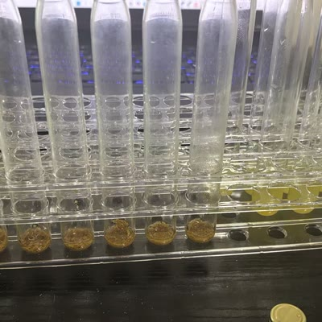</a></td>
          <td align="center" valign="middle">
            <a href="https://github.com/jw3422951-ops/cat-food-storage-study#prototype-and-mechanism">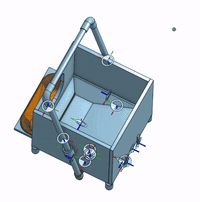</a> 
            
          </td>
        </tr>
      </table>
      <h3>Cat Food Storage and Automatic Feeder</h3>
      
<strong>Could a foil liner help keep kibble dry between feedings?</strong> I compared plastic and aluminum foil at four silica gel doses, with three independent containers per condition. Silica gel reduced loss on drying in both materials on Day 14. By Day 21, <strong>the reduction persisted only in foil</strong>. The 1 g and 2 g foil groups also had stronger iodine spot signals than foil alone. My next step is to test a foil-lined feeder compartment with silica gel at different humidity levels.

      
<strong>My contribution.</strong> I designed and ran the study, measured loss on drying and pH, quantified iodine spot intensity in ImageJ, and wrote the report. For the feeder prototype we built at <strong>Alba Studio</strong>, I modeled the motor and gears for the underside drive. I worked through the order in which parts needed to move to resolve assembly interference, then independently created both CAD motion simulations shown above.

      
<a href="https://github.com/jw3422951-ops/cat-food-storage-study#results"><strong>See the chart and feeder animations →</strong></a> · <a href="https://github.com/jw3422951-ops/cat-food-storage-study/blob/main/reports/cat-food-storage-experiment.pdf">Read my lab report</a>

    </td>
  </tr>
</table>

## Floor tile design, test setup, and CAD animations

Across **100 single steps per design**, V3 stored **72.48 µJ per step** on average, about **6.23 times** the baseline's **11.63 µJ**. The spread relative to the mean (sample standard deviation divided by the mean) was **17.7%** for V3 and **54.6%** for the baseline. In separate 20-step charging runs, V3 stored an average of **1,484.62 µJ in total**, compared with **348.65 µJ** for the baseline.

<table>
  <tr>
    <td valign="top">
      
With Shaoxuan Xiong and Shuoqi Yang, I explored how a floor tile could transfer the motion of a footstep to a piezoelectric disc and store the resulting electrical energy in a capacitor. We started by replicating a published design. In our build, the glue-stick contacts deformed and damaged the discs, which raised a more specific question. <strong>How could we protect the disc and make the contact more consistent from one step to the next?</strong>

      
<strong>How the design evolved</strong>

      <ul>
        <li><strong>V1 · Sponge pads.</strong> We replaced the glue-stick contacts with sponge pads in a tile with eight discs wired in parallel. The pads provided a softer contact, but the output still depended on where we stepped.</li>
        <li><strong>V2 · Spring and impactor.</strong> We added moving impactors and return springs to explore whether the impactor could separate and make contact again as the upper plate rose. The voltage varied across steps and often dropped quickly after the first compression. Through the acrylic plate, we could see the relative motion between the plate and the impactors. I combined the team’s component models into the V2 CAD assembly and transcribed our displacement measurements for analysis.</li>
        <li><strong>V3 · Triggered release.</strong> We developed a center-punch mechanism in which a step compresses a spring until a mechanical trigger releases the moving part. That release delivers a short impact to the disc. We 3D-printed and assembled the mechanism, then verified that it could trigger. I also helped measure, record, and transcribe data from both V2 and V3 tests.</li>
      </ul>
      
<strong>How we tested the two designs</strong>

      
One person alternated between V3 and the single-disc sponge baseline, wearing the same shoes and stepping in the same spot. We used the same disc model and rectifier and discharged the 4.7 µF capacitor before each single-step trial. We calculated stored energy from the voltage change. Error bars for the 5-, 10-, and 20-step charging runs show sample standard deviation across five runs per condition.

      
<a href="https://github.com/jw3422951-ops/piezoelectric-floor-tile#design-evolution">Design evolution</a> · <a href="https://github.com/jw3422951-ops/piezoelectric-floor-tile#ab-experiments">Experiments and data</a> · <a href="https://github.com/jw3422951-ops/piezoelectric-floor-tile/blob/main/CREDITS.md">Team contributions</a>

    </td>
    <td align="center" valign="top" width="250">
      
<a href="assets/piezoelectric-floor-tile-v3-center-punch.gif">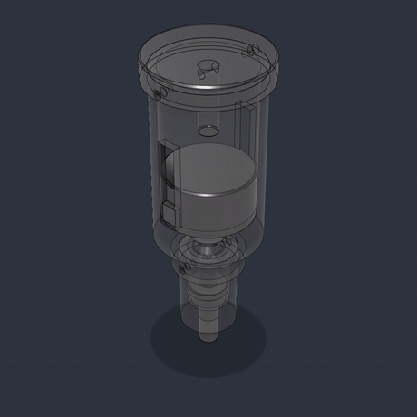</a> V3 center-punch animation

      
 V2 displacement simulation

      
 V1-derived baseline and V3 storage results

      
 Assembled V3 prototype

    </td>
  </tr>
</table>

## More projects

<table>
  <tr>
    <td width="50%" valign="top">
      

        <a href="https://github.com/jw3422951-ops/chemistry-portfolio/tree/main/experiments/45-luminescent-copper-iodide-complexes/assets">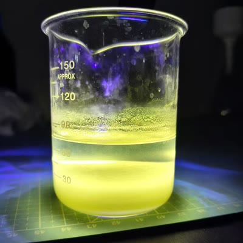</a>
        <a href="https://github.com/jw3422951-ops/chemistry-portfolio/tree/main/experiments/11-copper-sulfate-crystal-growth">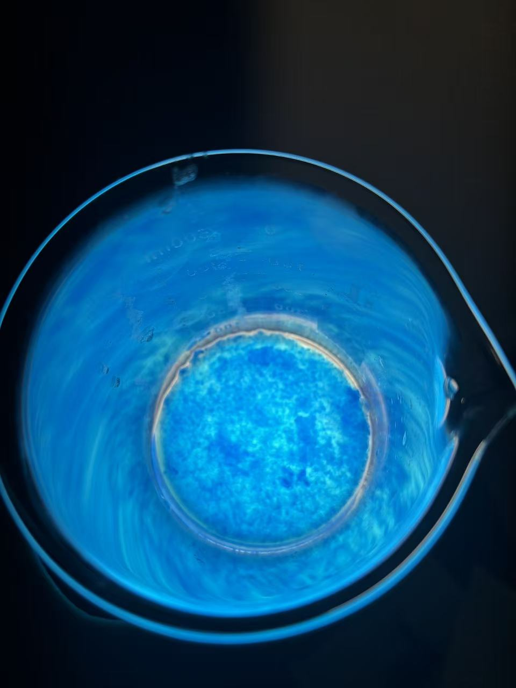</a>
        <a href="https://github.com/jw3422951-ops/chemistry-portfolio/tree/main/experiments/46-lithium-flame-test/assets">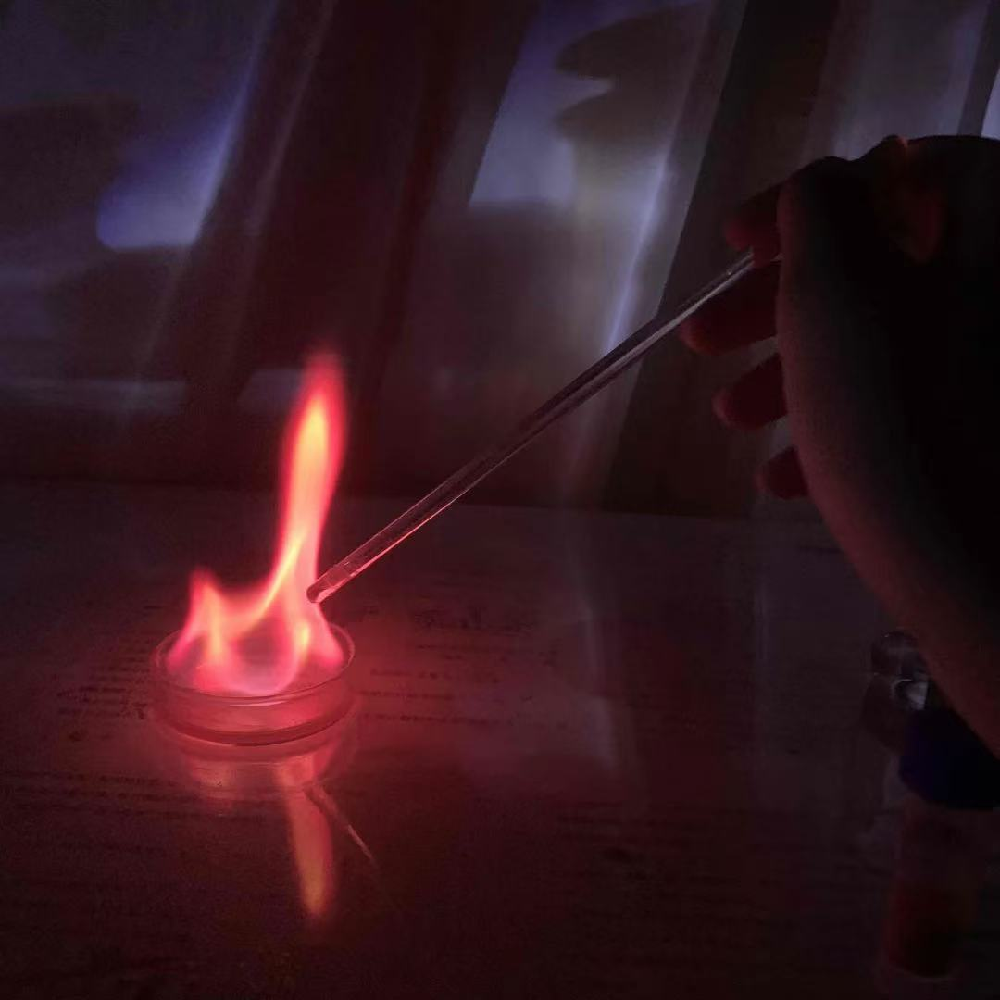</a>
         Copper–iodide glow · Copper sulfate recrystallization · Lithium flame test
      

      <h3>Independent Chemistry</h3>
      
I researched, planned, and carried out these experiments independently. The collection has <strong>49 entries and 10 written reports</strong>. In the blue-bottle experiment, I recorded the solution turning blue when shaken and fading at rest as methylene blue cycled between its oxidized and reduced forms.

      
In my <strong>28-day copper sulfate study</strong>, the particles I added had dissolved by Day 3. I prepared a supersaturated solution and later checked the sample every three days. The final photo shows four main blue crystals with visible faces and edges.

      
<a href="https://github.com/jw3422951-ops/chemistry-portfolio"><strong>Browse experiments →</strong></a>

    </td>
    <td width="50%" valign="top">
      <a href="https://github.com/jw3422951-ops/ccny-dna-detectives">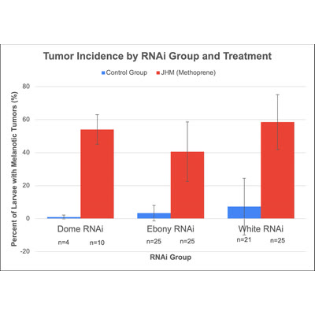</a>
      <h3>CCNY DNA Detectives</h3>
      
In CCNY’s spring 2026 DNA Detectives course, our team asked whether reducing <strong>Domeless</strong> expression would change tumor incidence in fruit fly larvae exposed to methoprene. The experiment used GAL4–UAS to activate RNA interference in specific tissues, with ethanol as the treatment control. The comparison between Domeless and White RNAi was inconclusive (p = 0.10).

      
I counted larvae with visible tumors under a microscope with my teammates and prepared <strong>Figure 1</strong>. I wrote portions of the introduction on the mechanism and RNAi, contributed to the results and conclusion of our unpublished paper, and helped cover the first result and limitations in our presentation.

      
<a href="https://github.com/jw3422951-ops/ccny-dna-detectives"><strong>Read the team study →</strong></a>

    </td>
  </tr>
  <tr>
    <td valign="top">
      <a href="assets/fermentation-presentation.jpg">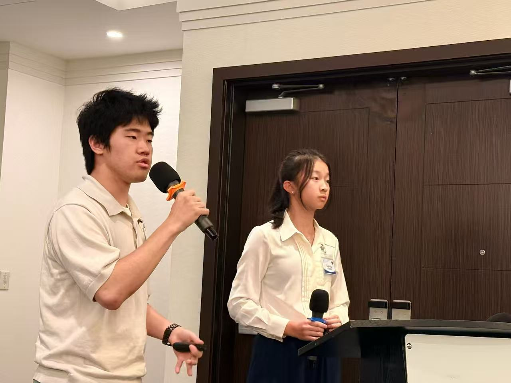</a>
      
      <h3>Fermentation Monitoring</h3>
      
After spending about 35 hours studying batch, fed-batch, and continuous fermentation through DTU’s online bioprocess course, I proposed that school labs use <strong>low-cost sensors</strong> to log an entire yeast fermentation batch. Students could compare how different runs progress and flag changes worth investigating.

      
In our talk, I used the <strong>Monod model</strong> to explain why growth slows as yeast uses up a limiting nutrient. Fitting the model would require measurements or calibrated estimates of both nutrient concentration and yeast growth. Our presentation earned <strong>Third Prize</strong> at the 2026 Youth AI Leadership Speech Challenge.

      
<a href="https://github.com/jw3422951-ops/fermentation-monitoring-proposal"><strong>Read the proposal and see the award →</strong></a> · <a href="https://www.5thaveclub.com/blog-posts/aishi-dai-shi-me-neng-li-bu-hui-guo-shi">Fifth Avenue Entrepreneurs Club event recap</a>

    </td>
    <td valign="top">
      <table>
        <tr>
          <td align="center" valign="top"><a href="assets/creditcan-team-model.jpg">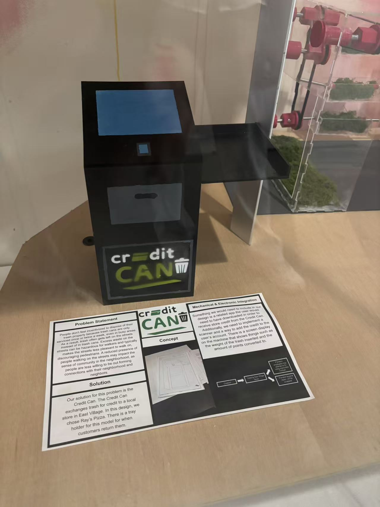</a> Year 1 team model</td>
          <td align="center" valign="middle"><strong>→</strong></td>
          <td align="center" valign="top"><a href="assets/creditcan-working-sorter.jpg">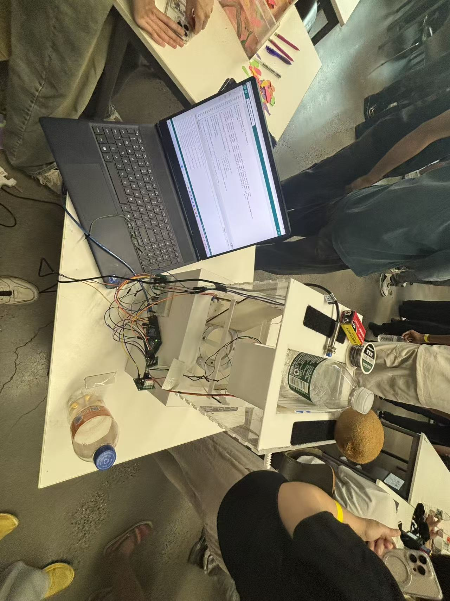</a> Year 2 independent build</td>
        </tr>
      </table>
      <h3>CreditCAN at Cooper Union</h3>
      
After interviewing people about neighborhood sanitation, our team proposed a recycling station that would offer local store credit for deposits. I modeled the concept in Onshape, and our team earned an <strong>Honor Award</strong>.

      
The next summer I independently built a working <strong>Arduino Mega 2560 sorter</strong>. It checks for metal and uses a time-of-flight sensor to estimate height. I enter the mass in the Serial Monitor. I wrote the Arduino C++ sketch that classifies items and moves the geared chute and rack-and-pinion pusher in sequence, routing items to one of four destinations.

      
<a href="https://github.com/jw3422951-ops/cooper-union-projects#creditcan"><strong>See how the sorter works →</strong></a> · <a href="https://github.com/jw3422951-ops/cooper-union-projects#firmware-and-motor-sequence">Firmware and motor sequence</a>

    </td>
  </tr>
</table>

## What I’m working toward

For my next yeast fermentation study, I want to see whether different conditions produce distinct patterns in the sensor readings over time. [Planned fermentation research](https://github.com/jw3422951-ops/fermentation-monitoring-proposal#future-research)
