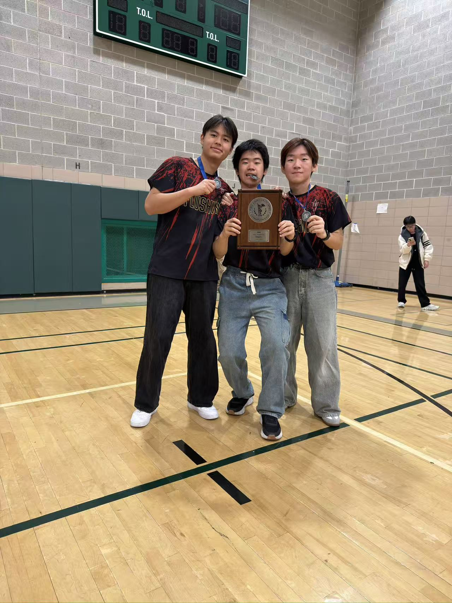
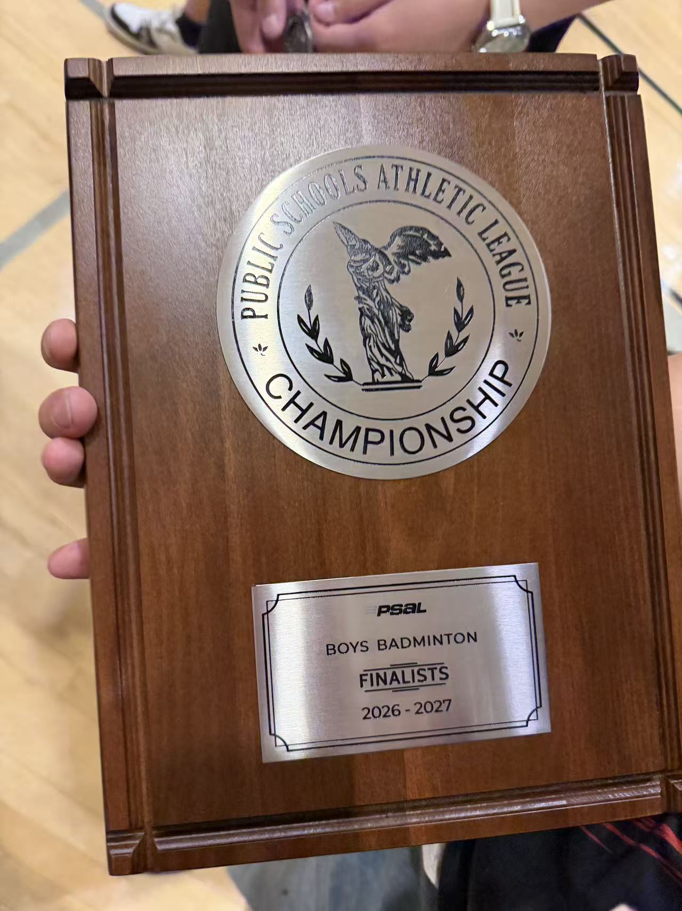

# Flushing Campus Boys Varsity Badminton

**PSAL City Championship Runner-Up · November 9, 2026**

Our team finished second in New York City, the first city runner-up finish in program history. I served as co-captain, played No. 1 singles, and coached teammates in singles and doubles during practice.

<table>
  <tr>
    <td align="center" valign="top"> With teammates after the city final</td>
    <td align="center" valign="top"> PSAL Boys Badminton Finalists plaque</td>
  </tr>
</table>

[PSAL match listing](https://www.psal.org/events-and-standings/school-calendar.aspx?schid=10501) · [Back to my GitHub profile](https://github.com/jw3422951-ops)
